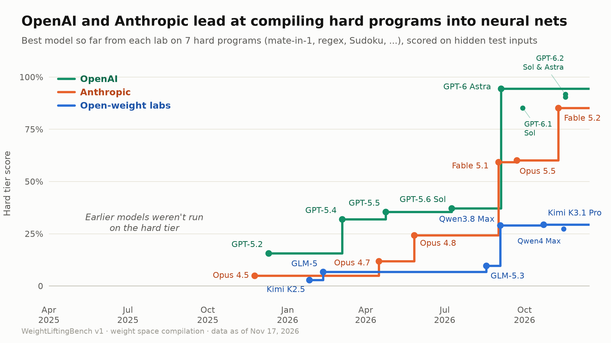
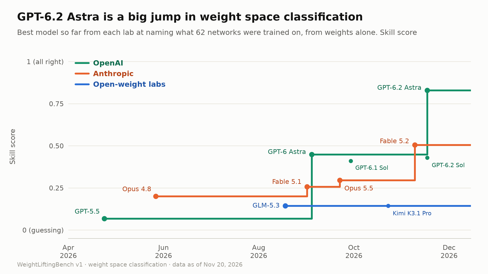
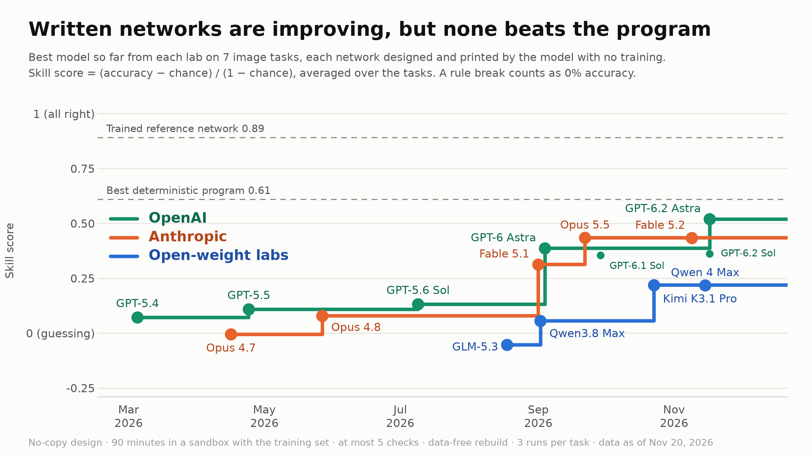

# WeightLiftingBench

**How much weight can LLMs lift when it comes to programming weight space?**

Frontier LLMs have recently shown they can work directly in the weight space of neural networks. "Weight space
programming" covers several different skills, though, and it is easy to mistake one for another. WeightLiftingBench
measures three of them separately, each as its own sub-bench.

| Sub-bench | The lift | The question | Where |
|---|---|---|---|
| **Compile** (Weight Space Compilation) | from an algorithm to weights | A simple deterministic program solves the task. Can a model match it only by setting the weights of a fixed MLP, in one reply with no tools? 14 tasks in two tiers: addition, sorting and gcd up to regex matching, Sudoku and Reed-Solomon decoding. | [`compile/`](compile/README.md) |
| **Understand** (Weight Space Understanding) | from weights to meaning | Small networks share a shape but were trained on different data. From the weights alone, can a model tell what a network was trained on? Atari policies, BERT-tiny fine-tunes and style transfer networks, with the easy clues removed. | [`understand/`](understand/README.md) |
| **Model** (Weight Space Modeling) | from data and prior knowledge to weights | The task is one normally left to gradient descent. Can a model design a network and print its weights by reasoning, with no training, fitting or copying? 7 image tasks: MNIST, GTSRB, Fashion-MNIST, Sign Language MNIST, Galaxy10, CIFAR-10, Visual Wake Words. | [`model/`](model/README.md) |

Each sub-bench keeps its own tasks, prompts, harness, scorer, and per-run results with run ids.

> **Large files.** The Model training and test sets (1.6 GB) and the Understand task weights (0.7 GB) are in the
> Hugging Face dataset [`tyranasaurus/WeightLiftingBench`](https://huggingface.co/datasets/tyranasaurus/WeightLiftingBench); `model/data/fetch.sh` and
> `understand/fetch_weights.sh` download and verify them.

## What we found

The work started at the Vals.ai hackathon (first place, Evals track). The full write-up is in the blog post (link to
come); the short version:

* **Compile.** Frontier models can now take many programs and print them straight into a network's weights. On the hard
  tier the best OpenAI and Anthropic models went from under 40% to over 80% in about three months. The best open-weight
  models are still under 30%, even though they score nearly as well on the usual coding benchmarks.
* **Understand.** GPT-6.2 Astra names what a network was trained on with a skill score of 0.83, up from 0.07 for
  GPT-5.5 in April. The strong models measure how far each weight moved during training and connect the biggest changes
  to what they know about each candidate dataset.
* **Model.** Asked to print networks for tasks normally left to gradient descent, models write a program and compile
  it. The best written networks (GPT-6.2 Astra, skill score 0.52) score below the best deterministic program written
  under the same rules (0.61) and far below a trained network (0.89).







Three takeaways:

1. New capabilities are clearly emerging at the frontier on weight space tasks, and GPT-6.2 Astra leads on most of the
   tasks we tried.
2. Most of the jump is Weight Space Compilation. We found no evidence yet that LLMs can compete with gradient descent,
   even on simple modeling tasks.
3. Open-weight models are far behind OpenAI and Anthropic models on all three, despite being benchmarked as nearly as
   capable in coding and other domains.

## Why three

Measuring Compilation and Modeling separately matters. Modeling is the more useful skill, but LLMs have become good at
presenting Compilation as Modeling: the networks they print for image tasks are mostly synthetic examples plus a
compiled program. A model writing the same examples and a plain Python program does just as well.

* **Compile** has a known program behind every task. It is the limit test: if a model cannot put a deterministic
  program into weights reliably, it is unlikely to work in weight space where no such program is known.
* **Understand** runs the other way. A model that can print or edit weights correctly should also be able to recognize
  patterns in trained weights and tell them apart.
* **Model** has no program to compile. It measures whether a model can produce weights that work on real data from its
  own reasoning, against two baselines: a deterministic program and a network trained with gradient descent.

Getting good at Compilation is probably a necessary first step toward real Modeling, and the benchmark is meant to
capture the moment models get there.

## Layout

```
compile/       Compile: the wsc-bench package, prompts, harness, results, tests (own README)
understand/    Understand: task prompts, harness, per-task results, scores and figures (own README)
model/         Model: tasks, rules, agent harnesses, verdicts, results and figures (own README)
```

To run the Compile tasks:

```bash
git clone https://github.com/tyranasaurus/WeightLiftingBench && cd WeightLiftingBench/compile
uv sync
uv run wsc-bench list
```

## Thanks

To [Valkyrie](https://docs.valkyrie.vals.ai), the Vals.ai evaluation platform, for running the benchmarks, to Modal for
compute, and to OpenAI and Anthropic for credits to evaluate their models.

## License

MIT, see [LICENSE](LICENSE). The Model data release has its own terms, see `model/data/README.md`.
