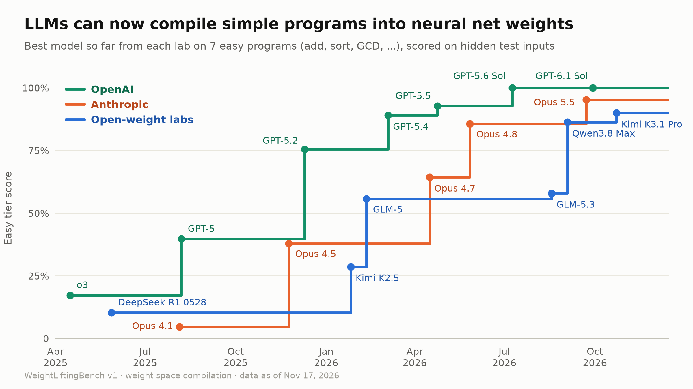
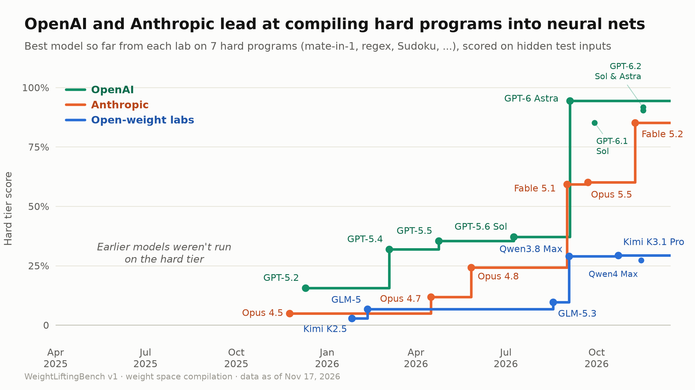
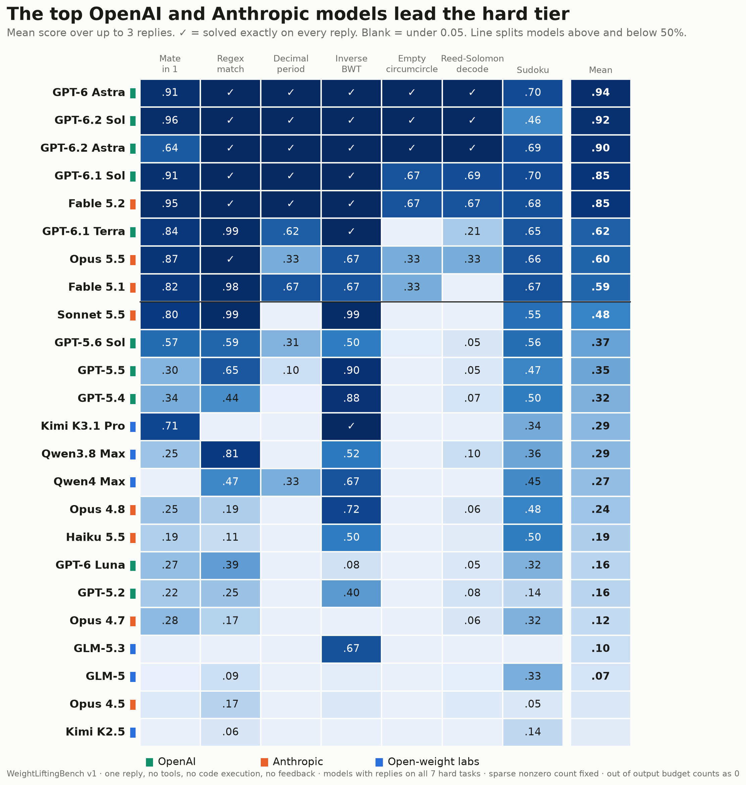

# Compile: Weight Space Compilation

Can a language model write the weights of a neural network by hand?

Each task gives a model a problem (add two numbers, sort a list, check a regex, decode a Reed-Solomon codeword) and
the exact shape of a ReLU network. The model replies **once** with a short Python program that sets the weights.
There are no tools, no code execution feedback, no training data and no examples. We run the program, then score the
network it built on freshly generated inputs. Every task has a known deterministic algorithm; the question is whether a
model can compile it into a network within the size limits.

This folder holds v1: the 14 tasks, the exact prompts, the harness that queried every model, the scorer, and the
per-run results with run ids.

## The rules

* **One request, one reply.** The model receives the task prompt (system prompt: `Answer the user's request.`) and
  answers once. Its reply must hold exactly one fenced ```` ```python ```` block.
* **The reply is a builder program.** It runs once in a fresh Python process with `np` (numpy), `math` and `weights`
  (every tensor preloaded with zeros) defined. An import hook blocks every import except numpy and math. That is a
  guard, not a hardened sandbox, so we also scanned the program of every reply that scored 0.9 or more (557 of them): none touched
  files, the environment or the network. The weights it leaves are the submission.
* **At most 500,000 nonzero weights and biases.** A network over the cap scores 0. When a reply's weights are over the
  cap, the harness answers in the same conversation with only the nonzero count and the cap, up to 2 follow-ups.
* **Scored only on the network.** The verifier runs the network on fresh random inputs (fresh seeds, not shown to the
  model) and reports the task's primary metric, a rate in [0, 1], averaged over several seeds.
* **Output budget.** Up to 128,000 output tokens per request (lower if the provider's maximum is lower). A reply cut
  in its visible text is continued, up to 4 requests. A reply cut while still reasoning, or cut on all 4 requests, is
  out of budget and scores 0.
* **Infrastructure errors never score.** Keys out of credit, a missing model, or provider errors after retries end
  the task as an error to retry, not a 0.
* **3 runs per model and task, effort high.** The hard tier is run only for models that clear the easy tier; the
  others show as "not run". chess-mate1 counts in the hard tier but was run for every model.

## Tasks

| Task | Tier | What the network computes | Network |
|---|---|---|---|
| [add-10digit](src/wsc_bench/prompts/add-10digit.md) | easy | sum of two 10-digit decimal integers | 8 layers x 512 |
| [sort10](src/wsc_bench/prompts/sort10.md) | easy | 10 real numbers in sorted order | 12 x 64 |
| [gcd10](src/wsc_bench/prompts/gcd10.md) | easy | gcd of two 10-bit integers, in binary | 8 x 2048 |
| [subleq-step](src/wsc_bench/prompts/subleq-step.md) | easy | one step of a SUBLEQ one-instruction computer | 12 x 1536 |
| [bowling](src/wsc_bench/prompts/bowling.md) | easy | ten-pin bowling score from a game's rolls | 32 x 1536 |
| [multiply32](src/wsc_bench/prompts/multiply32.md) | easy | product of two 32-bit integers, 64 bits out | 6 x 1536 |
| [arith-expr](src/wsc_bench/prompts/arith-expr.md) | easy | value of an infix expression with + - * and parentheses | 64 x 1536 |
| [chess-mate1](src/wsc_bench/prompts/chess-mate1.md) | hard | a mating move in mate-in-one positions from random self-play games | 8 x 4096 |
| [regex-match](src/wsc_bench/prompts/regex-match.md) | hard | which prefixes of a string match a regex given as input | sparse |
| [decimal-period](src/wsc_bench/prompts/decimal-period.md) | hard | period of the decimal expansion of 1/n | sparse |
| [sudoku-any](src/wsc_bench/prompts/sudoku-any.md) | hard | the solution of any unique-solution sudoku | 64 x 1536 |
| [inverse-bwt](src/wsc_bench/prompts/inverse-bwt.md) | hard | inverse Burrows-Wheeler transform | sparse |
| [empty-circumcircle](src/wsc_bench/prompts/empty-circumcircle.md) | hard | the empty-circumcircle (Delaunay) complex of 16 points | dense |
| [reed-solomon-decode](src/wsc_bench/prompts/reed-solomon-decode.md) | hard | corrected codeword and error locations, up to 5 errors | dense |

Each link is the exact prompt every model received. "Sparse" tasks take the network as `(layer, row, col, val)`
entry lists; the prompt gives the format. `wsc-bench list` shows each task's seed count.

## Quickstart

```bash
git clone https://github.com/tyranasaurus/WeightLiftingBench && cd WeightLiftingBench/compile
uv sync            # or: pip install -e .  (numpy is pinned to 2.5.4, the version v1 used)
uv run wsc-bench list
uv run wsc-bench prompt gcd10 > prompt.md         # send this to any model, save its full reply as reply.md
uv run wsc-bench eval gcd10 reply.md              # run the reply's program and score the network
uv run wsc-bench score gcd10 weights.npz          # or score a weights file directly
```

`eval` applies the same rules as the harness: exactly one python block, numpy and math only, a 600 s limit, the
nonzero cap. It does not send the cap follow-ups; `run` does.

## Reproducing our runs

`wsc-bench run` queries a model through the same harness we used ([harness/api_wsp](harness/api_wsp)), in the same
sandbox image (Python 3.12.8, numpy 2.5.4), then scores the reply. It needs Docker and an API key in your environment.

```bash
export ANTHROPIC_API_KEY=...      # and/or OPENAI_API_KEY, GEMINI_API_KEY, OPENROUTER_API_KEY
uv run wsc-bench run gcd10 --model anthropic/claude-opus-5-5 --effort high
uv run wsc-bench run all --model openai/gpt-6.1-sol
```

Model ids: `anthropic/<id>` goes to the Anthropic Messages API, `openai/<id>` to the OpenAI Responses API,
`google/<id>` to the Gemini API, and anything else to OpenRouter. Each run leaves `runs/<task>/<model>-<time>/` with
the prompt, the full agent log and trajectory, the weights and `result.json`.

Our official runs used private evaluation seeds, so nobody can tune a reply to them; this repository scores with
public seeds starting at 0. Rewards agree up to sampling noise.

## Results





The blog's four Compile charts and the code that draws them are in [blog-charts/](blog-charts/README.md).



Hard tier, per model and task: mean `reward_fixed_count` over up to 3 replies (out of output budget counts as 0), for OpenAI,
Anthropic and open-weight lab models with replies on all 7 hard tasks. ✓ = solved exactly on every reply; blank = under
0.05. `scripts/hard_tier_heatmap.py` draws it from `results/blog_v1_runs.csv`.

The headline results and analysis are in the blog post (link to come). Every reply behind them is in [results/](results):
`runs.csv` lists each run id, model, label and dataset, and `task_results.csv` holds the verifier reward and the
out-of-budget, provider-failure and cut flags for every (run, task). `blog_v1_runs.csv` lists every reply behind the
blog's numbers, and `python scripts/blog_v1_scores.py` recomputes them. See [results/README.md](results/README.md).

## Layout

```
src/wsc_bench/
  benchmark.json      the 14 tasks: task module, parameters, cap, seed count
  prompts/            the exact prompt of each task
  tasks/              one module per task (input generator, reference algorithm, scorer) and the shared MLP code
  build.py            reply -> weights: the v1 sandbox runner
  score.py            weights -> reward: the v1 verifier
  run.py, cli.py      the wsc-bench command
  data/               Lichess mate-in-one puzzles (CC0) for chess-mate1
harness/api_wsp/      the agent that queried every model (provider routing, continuation, cap retries)
harness/image/        the agent sandbox image
results/              every v1 run and per-task reward
scripts/              how results/ was collected
tests/
```

## Known issues in v1

* **Two size limits in two prompts.** The regex-match and decimal-period prompts state the network format's own
  entry limit (4,000,000 and 10,000,000 array slots) and also the 500,000 nonzero cap. The 500,000 cap is the one
  that applies. We keep the prompts as served.
* **Sparse nonzero count.** For regex-match and decimal-period, the v1 verifier and harness counted the index arrays
  of a sparse submission as well as its values, so some replies within the cap were scored 0 and told they were over
  it. This repository counts nonzero values plus biases.
  `results/` keeps the v1 verifier's `reward` and adds `reward_fixed_count`, what the reply scores with the fixed
  count throughout (no model is rerun). The old count also made the harness tell some replies their network was over
  the cap and ask for a smaller one, so for regex-match, decimal-period and inverse-bwt the scored attempt is the first
  one whose code fails or whose real count is within 500,000, the one the harness would have accepted. It is rebuilt
  from the reply and scored by the v1 verifier on the same hidden seeds. The blog post uses `reward_fixed_count`. It
  differs from `reward` for 54 of 1,391 Valkyrie replies and 11 of 42 local replies, and raises 19 models' hard tier
  scores. A few replies score lower, where the smaller resubmitted network had scored better than the first.
* **No rule against training inside the builder program.** The prompt does not forbid a builder program from
  simulating the task and fitting the weights to it. We scanned all 1,010 builder programs from v1 tasks for training
  or fitting (least squares, gradient descent, optimizers, loss loops). Two fit their weights: a GPT-5.1 sort10 reply
  that trains with Adam (reward 0.0) and a GPT-5.5 empty-circumcircle reply that solves a ridge regression (reward
  0.0002). None of the 1,010 got a good score by training. A no-training rule, a CPU limit and a build-program judge
  are planned for v2.
* **The output budget penalizes long reasoners.** A reply still reasoning at 128,000 tokens scores 0. Some models hit
  this a lot: Qwen4 Max on 13 of its 21 hard-tier replies, Opus 5.5 on 5 of 21 at effort high. v2 drops the shared
  cap, so each model gets its provider's full output limit, and states the budget in the prompt.
* **Small samples.** 3 runs per cell. 19% of easy-tier cells change result across runs, mostly for models that are
  just starting to pass a task, so treat a few points between neighbouring models as noise.
* **Thin Google and Meta coverage.** Of the Gemini 4 models, only Carbon has replies on every task. Gemini 4
  Hydrogen and Meta's Muse Wonder have the easy tier and chess-mate1 only. Neither lab is charted in the blog.

## Future directions

Questions v1 raises and does not answer:

* **Compressibility.** Sweep the nonzero cap for each task and report the smallest network with which each model still
  solves it: a compiled size per model and task, comparable to a hand-built reference network.
* **Looping and recursive programs.** v1 networks have a fixed number of layers, so a program whose step count depends
  on the input has to be unrolled. Give models a weight-tied block applied many times, or a recurrent cell, and score
  tasks such as several steps of the SUBLEQ computer or sudoku with search.
* **Depth and width.** Hold a task fixed and vary the shape of the network, to find where each model's construction
  stops working, and let models choose the shape themselves.
* **Tasks with no known program.** Image classification, tabular prediction and game policies have no exact algorithm
  to compile. Score hand-written weights against a trained network of the same shape, and place tasks along the
  range from fully deterministic to learned.
* **Weights or any unfamiliar target.** Compile the same tasks into other unusual targets (an esoteric language, lambda
  calculus, a circuit netlist) and check whether the scores move together with this benchmark.
* **Reading networks.** Hand a model a compiled network and ask which program it computes.
* **Self-prediction.** Ask models to predict which tasks they or another model can compile, and score the calibration.


## License

MIT for the code. The chess puzzles come from the Lichess puzzle database (CC0).
