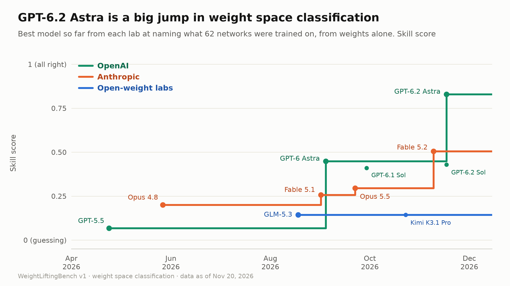
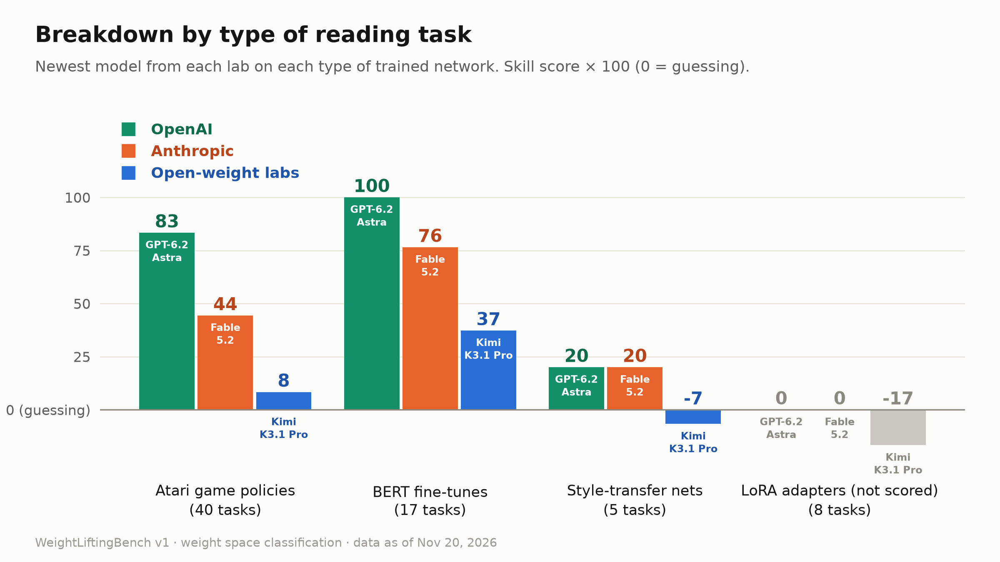

# Understand: Weight Space Understanding

The Understand sub-bench of WeightLiftingBench. If LLMs are to print or edit weights correctly, they should also be able
to recognize patterns in trained weights and tell them apart. Here a model gets the weights of a small trained network
and has to say what the network was trained on.

The networks in a family share an architecture and differ only in their training data. When we reproduced earlier work
(including Takehi et al.), models found easy clues that let them answer without much reasoning about the weights, such
as mapping output neurons to a game's actions. These tasks remove those clues.



## Tasks

70 tasks in four families. 62 are scored; the 8 LoRA tasks are a negative control.

| Family | Networks | What we removed | Question | Scored |
|---|---|---|---|---|
| Atari | 40 game policies (Stable-Baselines3 RL Zoo), about 1.7M weights | the layer that reads pixels and the action head | Which of 10 games? | yes |
| BERT-tiny | 17 fine-tunes, about 4.4M weights | the classifier head (the vocabulary is given) | Which of 4 tasks? | yes |
| Style transfer | 5 Johnson et al. style networks | the layers that read and write colour | Which of 4 paintings? | yes |
| LoRA | 8 Mistral-7B adapters (LoRA Land) | the adapters of the first and last 4 layers (no base model given) | Which of 4 tasks? | no |

* The Atari policies are small CNNs that look at the last few game frames and pick a joystick action. The BERT
  fine-tunes all start from the same pretrained BERT-tiny and are each trained to classify text for one dataset. The
  style networks are CNNs that repaint any photo in the style of one painting. The LoRA adapters are small low-rank
  add-ons to Mistral-7B, each trained for one task.
* Every weight is cast to 16-bit floats and the units within each layer are shuffled, which removes clues like unit
  order without changing what the network computes.
* `tasks/<task>/instruction.md` is the exact prompt of each task, and `tasks.csv` lists each task's family and answer.

## Rules

* **Tools:** Python with numpy only, up to 30 code runs per task, 30 minutes, no internet beyond the model's own API.
* **No running the network.** The model may not run the network, or any layer of it, on inputs it constructs. Every
  run was audited, and the two answers that broke this rule are scored as wrong
  (`results/rule-break-overrides.json`).
* **Answer:** a final line `ANSWER: <option>` in `/app/out/answer.txt`, graded by `tasks/<task>/tests/grade.py`.
* **Harness:** `harness/api_wsp` in its read mode, the agent every reading run used.

## Scoring

* Skill score = (accuracy minus chance) / (1 minus chance), so 0 is a random guess and 1 is all right. Chance is 0.10
  for Atari and 0.25 for the other families. The headline score covers the 62 scored tasks.
* One run per task, so each headline score is good to about ±0.07.
* **Reruns.** When a task ended with no answer because of the harness (out of code runs, a timeout, an empty reply, or
  a reply cut by an early version of the harness), we reran it once, for every model the same way: all such tasks for a
  model, not only the ones it got wrong. A rerun's result replaces the first attempt's, right or wrong.
* **LoRA is not scored.** Without the base model nothing says what an adapter direction means, and every model was at
  guessing level. Given the base model the task became easier than BERT, with most models scoring perfectly.

## Results (skill score)

| Model | Released | All 62 | Atari (40) | BERT (17) | Style (5) | LoRA (8, not scored) |
|---|---|---|---|---|---|---|
| GPT-6.2 Astra | 2026-11-17 | **0.83** | 0.83 | 1.00 | 0.20 | 0.00 |
| Fable 5.2 | 2026-11-09 | **0.50** | 0.44 | 0.76 | 0.20 | 0.00 |
| GPT-6 Astra | 2026-09-04 | **0.45** | 0.42 | 0.69 | -0.07 | 0.00 |
| GPT-6.2 Sol | 2026-11-17 | **0.43** | 0.42 | 0.53 | 0.20 | 0.00 |
| GPT-6.1 Sol | 2026-09-29 | **0.41** | 0.36 | 0.53 | 0.47 | 0.00 |
| Opus 5.5 | 2026-09-22 | **0.30** | 0.31 | 0.37 | -0.07 | 0.00 |
| Fable 5.1 | 2026-09-01 | **0.26** | 0.22 | 0.53 | -0.33 | 0.17 |
| Opus 4.8 | 2026-05-27 | **0.20** | 0.22 | 0.29 | -0.33 | 0.00 |
| Kimi K3.1 Pro | 2026-10-23 | **0.14** | 0.08 | 0.37 | -0.07 | -0.17 |
| GLM-5.3 | 2026-08-18 | **0.14** | 0.06 | 0.45 | -0.07 | -0.17 |
| GPT-5.5 | 2026-04-24 | **0.07** | 0.08 | 0.06 | -0.07 | 0.05 |



* Most of the progress over time is on Atari and BERT, with GPT-6.2 Astra perfect on BERT. Style transfer stays hard
  for every model. The open-weight models are flat and near guessing.
* **How the strong models read weights.** They measure how far each weight moved from where training started, then
  connect the biggest changes to what they know about each option. For BERT, the words whose embeddings moved most hint
  at the dataset. For Atari, the parts of the screen the network attends to hint at the game. The last step relies on
  world knowledge, and some models did the same analysis but could not connect what stood out to a specific task.
* **Style transfer.** The style networks are trained from scratch with their colour layers removed, so there is no
  starting point to compare against, and every weight gets trained. The one partial exception is Pointillism, which
  four models got right.

## Caveats

* **Not included.** Gemini 4 was dropped after a 3-task check (an output cap through OpenRouter, failures and slow
  replies through Google's API). Qwen 4 Max was dropped because its only provider was too slow for the 30-minute limit.
* **Without the rule break ruling** Fable 5.2 would score 0.52 and Opus 5.5 0.31. Where exactly to draw the line on
  forward passes is left for a next version.
* **First attempts alone:** Opus 5.5 scores 0.22 (10 tasks rerun), Opus 4.8 0.12, GLM-5.3 and Kimi K3.1 Pro about 0.10
  each (37 tasks rerun between the three, 11 then right). GPT-5.5 had no lost tasks.
* **GPT-5.5** has 69 of 70 tasks: one LoRA task has no result.
* **Weights are hosted separately.** Each task needs a weights file (`policy.npz`, 0.7 GB for all 70) that its
  Dockerfile copies in. They are in the Hugging Face dataset [`tyranasaurus/WeightLiftingBench`](https://huggingface.co/datasets/tyranasaurus/WeightLiftingBench)
  under `understand/weights/`; `bash fetch_weights.sh` puts each one in its task folder and checks it against
  `weights-SHA256SUMS.txt`.
  Answer keys are in this repository: each task's accepted answers are in `tests/expected.json`, and `tasks.csv` has
  an `answer` column.
* **The task builders are as recovered.** `builder/` holds the scripts that made the scored set from the source
  checkpoints (16-bit rounding, unit shuffling, option lists). They were recovered from a session transcript and have
  not been rerun since.

## Where things are

| What | Where |
|---|---|
| Task prompts, task settings, grader and answer key | `tasks/<task>/` (`instruction.md`, `task.toml`, `tests/grade.py`, `tests/expected.json`, `solution/solve.sh`) |
| Task list with families and answers | `tasks.csv` |
| Downloading the task weights | `fetch_weights.sh`, `weights-SHA256SUMS.txt` |
| Task builders (wsu-reading v6 to v10) | `builder/` (own README) |
| Agent harness, as the runs used it | `harness/api_wsp/` |
| Per-task results that count: model, task, family, run label, Valkyrie run id, reward | `results/task_results.csv` |
| Scores per model and family | `results/scores.json` |
| Every Valkyrie run id, by label | `results/run_ids.txt` |
| Rule breaks scored 0, and regraded answers | `results/rule-break-overrides.json`, `results/regrade-overrides.json` |
| Collecting results from Valkyrie, and scoring | `scripts/collect_results.py`, `scripts/score.py` |
| Charts | `scripts/plot_reading_frontier.py`, `scripts/plot_reading_families.py`, `results/figures/` |

To recompute the scores and redraw the charts:

```bash
python understand/scripts/score.py
uv run --no-project --with matplotlib python understand/scripts/plot_reading_frontier.py
```
